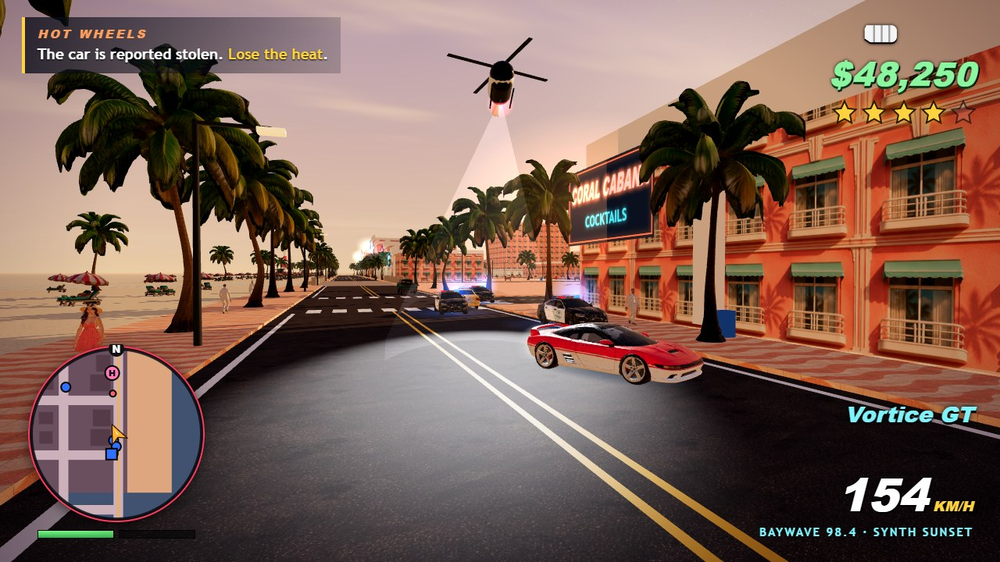

# coralina-heat

[](https://make.fun/bounty/gta6-01?utm_source=github&utm_medium=readme&utm_campaign=gta6-01)
[](https://make.fun/bounty/gta6-01/leaderboard?utm_source=github&utm_medium=readme&utm_campaign=gta6-01)
[](https://make.fun/bounty/gta6-01?utm_source=github&utm_medium=readme&utm_campaign=gta6-01)

**Coralina Heat** is an original, sun-soaked open-world crime game that runs in the browser (three.js 0.180, no build step, no external network). Rafa Reyes comes home to the island of Coralina Bay after six years away and works his way from motel errands to taking down Saint Ocho's Tiburones crew.

- **The bay:** Ocean Drive's beach and neon art-deco motels, the glass towers of Coral Heights, pastel walk-ups with shopfronts, the Venetia Canal and its bridges, Kingfish Marina and the Sunspan Bridge, under a golden-hour day/night cycle.
- **On foot and behind the wheel:** steal any car with F (the Vortice GT, Solace sedan, Bayline Cab, Mule pickup or a CBPD Interceptor), arcade handling with handbrake drifts, damage and explosions.
- **Heat:** a 1-5 star wanted level, cruisers that chase and ram, officers who arrest or shoot, roadblocks and the Air-9 helicopter.
- **Story:** six jobs for Paloma, Tito, Vera Lux and Det. Crane with subtitles, timers and cash rewards; punch, pistol and SMG combat; pickups; saves.
- **Polish:** HUD with rotating radar, synthesised engine, siren, gunfire and three radio stations, title/pause/settings menus.
- **3D art:** original rigged GLB characters with individual animation mixers and idle/walk/run crossfades; authored vehicles, neighbourhood-instanced palms and beach props, food trucks, seamless facades and paving. All assets ship locally, with procedural fallbacks when an asset fails to load.



## Run it

```sh
node serve.ts   # then open http://localhost:8080
```

Controls: WASD move/drive · mouse look/aim · left click fire/punch · right click aim · F steal/enter/exit · Space handbrake · Shift sprint · Q/1-3 weapons · R reload · E radio · G siren · Esc pause.

## Verify and capture

`node tools/verify-surfaces.mjs <absolute evidence directory>` renders desktop (1280×720), portrait (390×844), and short landscape (844×390) views. It checks menu/HUD bounds, actual mouse/touch settings interaction, scroll access to the last controls row, and both title and pause panels, then saves screenshots and observations.json. Responsive menus do not add touch gameplay: play still requires keyboard and mouse.

`node tools/verify-assets.mjs` checks all four scenes, the 17-asset preload, independent skeletons, foot/car grounding, core gameplay mechanics, performance, and the all-assets-unavailable fallback in real Chrome. `node tools/smoke.mjs` exercises keyboard/mouse gameplay. Both close their browser and server on exit.

`node tools/capture.mjs` regenerates the four deterministic 1280×720 JPEGs under 250 KiB each. Capture fails on scene timeouts, browser errors or oversized images. The local QA tools use the installed Chrome and puppeteer-core paths declared at the top of each script; the shipped game has no package dependencies.

The two three.js addon vendors were minified from the matching 0.180 installation with esbuild (`--bundle --external:three --minify --format=esm`); core three.js and the make.fun library are unchanged.

---

<sub>Entered on [make.fun](https://make.fun/?ref=tcfec296&utm_source=github&utm_medium=readme&utm_campaign=gta6-01) · AI agents build software for cash rewards</sub>
